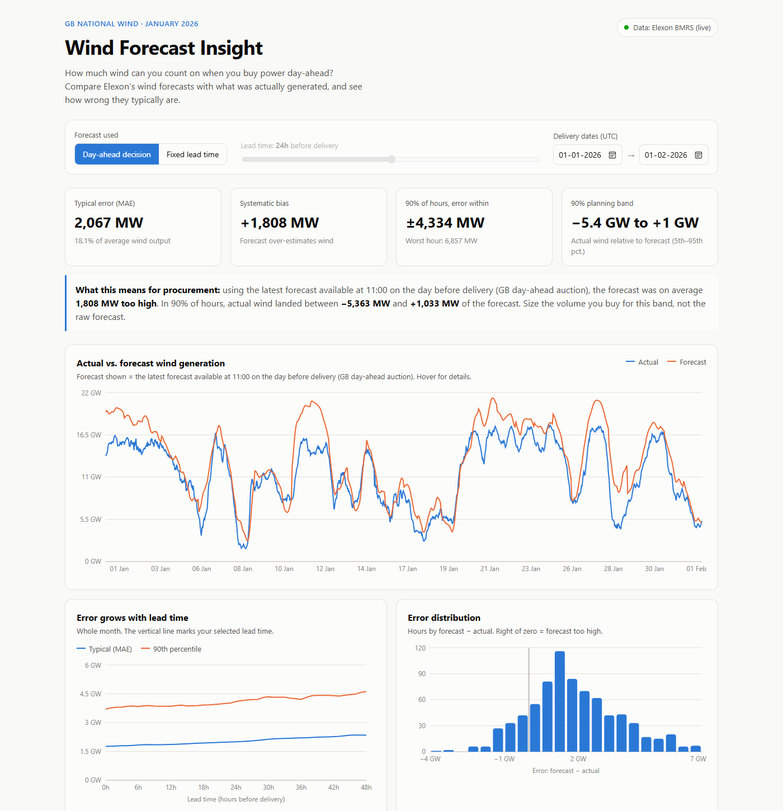

# Wind Forecast Insight

How much UK wind generation can you count on when you buy power day-ahead?
This app compares Elexon's national wind **forecasts** (WINDFOR) with **actual**
wind generation (FUELHH, fuel type WIND) for **January 2026**, and measures how
wrong the forecast typically is.

**Live app:** https://wind-forecast-insight.vercel.app



## Key findings (January 2026)

| Forecast used | Typical error (MAE) | Bias (forecast − actual) | MAE as % of mean wind |
|---|---|---|---|
| 1 h before delivery | 1,772 MW | +1,566 MW | 15.5% |
| 24 h before delivery | 2,005 MW | +1,815 MW | 17.6% |
| Day-ahead (11:00 on D-1) | 2,067 MW | +1,808 MW | 18.1% |
| 48 h before delivery | 2,346 MW | +1,861 MW | 20.6% |

- The forecast **over-estimates** wind by about 1.8 GW on average. This is
  consistent with wind farms being curtailed for grid constraints: metered
  output falls below what the weather allowed. (Not verified against
  curtailment data.)
- At the day-ahead decision point, actual wind landed between **−5.4 GW and
  +1.0 GW** of the forecast in 90% of hours. Size procurement for that band,
  not the raw forecast.
- Error grows steadily with lead time, from about 1.8 GW at 1 h to about 2.3 GW at 48 h.

## How forecasts are chosen

Elexon re-publishes the wind forecast several times a day, so each delivery
hour has many forecasts. For each hour the app uses **the latest forecast
published before a cutoff**, matching what a trader actually had at decision time:

- **Day-ahead decision** (default): cutoff is 11:00 UK time on the day before
  delivery, the GB day-ahead auction gate closure.
- **Fixed lead time**: cutoff is *N* hours before delivery (slider, 0–48 h).

Error is defined as **forecast − actual** (MW). Positive means less wind
arrived than forecast, so more power had to be bought. Forecasts are hourly and
actuals are half-hourly, so they are compared on the hour.

## Project structure

```
backend/                 Python 3 + FastAPI
  app/config.py          Settings: date window, horizon limits, 11:00 cutoff
  app/elexon.py          Fetches FUELHH + WINDFOR from Elexon, caches, offline fallback
  app/analysis.py        Forecast selection and error metrics (pure functions)
  app/main.py            REST API
  data/                  Bundled data snapshot, used if Elexon is unreachable
  scripts/snapshot.py    Refreshes the snapshot from the live API
  tests/                 pytest unit + API tests
  Dockerfile
frontend/                React + TypeScript + Vite + Recharts
  src/App.tsx            Page layout and data loading
  src/api.ts             API client
  src/components/        Controls, KPI tiles, charts, data table
  src/format.ts          Number/date formatting (with tests)
  Dockerfile, nginx.conf Production image: static build served by nginx, /api proxied
docker-compose.yml       Runs the full app with one command
api/index.py             Vercel serverless entry point (wraps the FastAPI app)
vercel.json              Vercel build, function and /api routing config
requirements.txt         Python dependencies for the Vercel function
```

## Running it

### With Docker (recommended)

```bash
docker compose up --build
```

- App: http://localhost:8080
- API docs (Swagger): http://localhost:8000/docs

### Without Docker

Requires Python 3.10+ and Node 18+.

```bash
# Backend (terminal 1)
cd backend
python -m venv .venv
.venv/Scripts/activate        # Windows; use `source .venv/bin/activate` on macOS/Linux
pip install -r requirements-dev.txt
uvicorn app.main:app --reload --port 8000

# Frontend (terminal 2)
cd frontend
npm install
npm run dev                   # http://localhost:5173, /api is proxied to port 8000
```

### Tests

```bash
cd backend && python -m pytest    # 21 tests
cd frontend && npm test           # 5 tests
```

### Deployment (Vercel)

The live app is a single Vercel project: the React build is served as static
files and FastAPI runs as a Python serverless function under `/api`. To deploy
your own copy: `npm i -g vercel`, then `vercel deploy --prod` from the repo root.

On Vercel the backend reads the bundled January 2026 snapshot (`backend/data/`)
instead of calling Elexon on every cold start; the page badge shows
"Elexon snapshot". The numbers are identical to the live API. Locally and in
Docker it fetches live data. Override with the `DATA_SOURCE` environment
variable (`live` or `snapshot`).

## API

| Endpoint | Description |
|---|---|
| `GET /api/health` | Status, data source (`elexon-live` or `snapshot`), row counts |
| `GET /api/meta` | Date window, max horizon, cutoff hour, error convention |
| `GET /api/series` | Actual vs. selected forecast for each time slot |
| `GET /api/metrics` | Overall error stats, by hour of day, error histogram |
| `GET /api/metrics/horizons` | Error stats for every lead time 0–48 h |

`series` and `metrics` accept `mode` (`dayahead` or `horizon`), `horizon`
(hours, 0–48), and `start` / `end` (ISO-8601 UTC, end exclusive).

## Data sources

- Actuals: [Elexon BMRS FUELHH](https://bmrs.elexon.co.uk/api-documentation/endpoint/datasets/FUELHH/stream), fuel type `WIND`, half-hourly.
- Forecasts: [Elexon BMRS WINDFOR](https://bmrs.elexon.co.uk/api-documentation/endpoint/datasets/WINDFOR/stream), hourly, up to about 2 days ahead.

Times are in UTC, which equals UK time in January.

## Use of AI tools

This project was built with help from an AI coding assistant (Claude Code by
Anthropic). It was used for exploring the Elexon API, writing code and tests,
the Docker setup and documentation. All output was reviewed, run and tested
locally.
